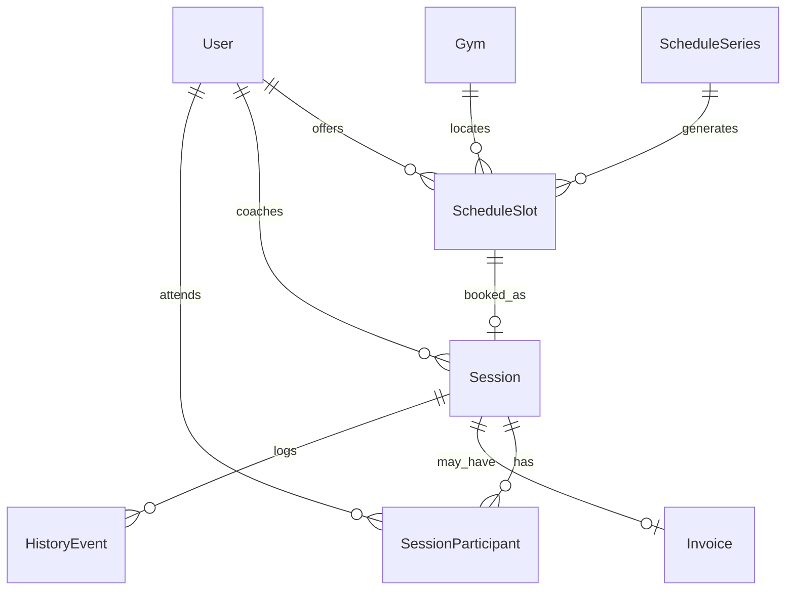

# Calendar architecture (Fitness Yoda)

Календарь — **основа продукта**: вокруг него крутятся запись, проведение занятия, история, позже фактуры и планы.  
Этот документ описывает **целевую модель** и **MVP-срез**. Реализация фазы `schedules-sessions` должна не ломать целевую модель.

## 1. Две оси времени (не смешивать)

| Слой | Смысл | Примеры |
|------|--------|---------|
| **Availability** | Что тренер *предлагает* | свободные окна, позже — recurring rules |
| **Appointment (Session)** | Что *забронировано / проведено* | занятие ученика, статус lifecycle |

Ошибка: хранить «календарь» только как список sessions без отдельной доступности — тогда нельзя показать свободные слоты и сложно генерировать окна из правил.  
Ошибка наоборот: пытаться выразить занятие только флагом на слоте без богатого Session — тогда некуда вешать complete/cancel, invoice, plan, history.

**Правило:** Session — канонический «факт занятия». Slot — инвентарь bookable capacity.

```text
Availability (ScheduleSlot [/ Series])
        │ book
        ▼
   Session (appointment)
        │ lifecycle (фаза 5+)
        ▼
 completed / cancelled / no_show → History / Invoice / …
```

## 2. Целевая модель (эволюция)



### 2.1 ScheduleSeries (будущее, не MVP UI)

Правило повторения («каждый пн 10:00–11:00»).  
Генератор материализует `ScheduleSlot` на горизонт (например 8 недель).  
MVP: серии нет; слоты создаются явно.

### 2.2 ScheduleSlot (MVP + основа)

Bookable окно тренера.

Обязательные поля сейчас:
- `coachId`, `startsAt`, `endsAt` (`timestamptz`), `mode` (`online`|`offline`)
- статус доступности: `open` | `booked` | `blocked` (MVP: `open`/`booked`; `blocked` — задел)

Nullable заделы (колонки можно добавить сразу как NULL):
- `seriesId`, `gymId`, `timezone` (IANA, если слот «наивный» — предпочтительно всё же абсолютный `timestamptz`)
- `capacity` (default 1) — для будущих групп

Инварианты:
1. `endsAt > startsAt`
2. Для одного coach два **open**-слота не должны **пересекаться** (half-open interval `[startsAt, endsAt)`)
3. Слот `booked` имеет ровно одну активную Session (1:1 MVP) или `bookedCount < capacity` (позже)

### 2.3 Session (MVP + основа)

Каноническое занятие.

Сейчас:
- `coachId`, `studentId` (1:1), `scheduleSlotId` (required в MVP), `startsAt`/`endsAt` (копия со слота на момент booking — snapshot), `mode`, `status`, `createdBy`

Статусы (полный набор в типе/CHECK, переходы — по фазам):
```text
booked → completed
booked → cancelled
booked → no_show
```
MVP создаёт только `booked`. Переходы — `session-lifecycle-history`.

Snapshot `startsAt`/`endsAt` на Session нужен, чтобы:
- не ломать историю, если слот когда-то изменят/удалят политикой;
- отдавать календарь appointments без join на availability.

### 2.4 SessionParticipant (будущее)

Замена единого `studentId` для групп.  
Миграционный путь: перенести `studentId` в participant row `role=student`, затем сделать `studentId` nullable/deprecated.

### 2.5 Gym (будущее)

Справочник места. MVP: `gymId` null.

## 3. MVP-срез (что реализуем сейчас)

1. CRUD/list `ScheduleSlot` для тренера (`open`).
2. Student (linked) видит `open` слоты coach.
3. Book → атомарно: slot `open`→`booked` + Session `booked` (транзакция).
4. Coach book for linked student — тот же путь.
5. `GET /sessions` — календарь appointments текущего пользователя (+ опциональный `?status=`).
6. Lifecycle: `booked → completed | cancelled | no_show` + append-only history events.
7. **Политика cancel (MVP):** ScheduleSlot **не** возвращается в `open` (слот остаётся `booked`; reopen — позже).
8. Без recurrence UI, без groups.

## 4. Backend module layout (Nest)

Рекомендуемая структура (имена можно слегка варьировать):

```text
backend/api/src/
  calendar/                    # optional umbrella
    calendar.module.ts         # exports domain helpers if shared
  schedules/
    schedules.module.ts
    schedules.controller.ts
    schedules.service.ts       # availability use-cases
  sessions/
    sessions.module.ts
    sessions.controller.ts
    sessions.service.ts        # booking + list
  database/entity/
    schedule-slot.entity.ts
    session.entity.ts
```

**Domain rules** (overlap, link check, book transaction) держать в service-слое / маленьком `CalendarBookingService`, не в controllers.

Permissions — как обычно через `RequirePermissions`.

## 5. Concurrency & integrity

Критично для «основы»:

1. **Транзакция** на book: `SELECT … FOR UPDATE` слота → проверка `open` → insert session → update slot `booked`.
2. **Unique** partial index: один active session на `schedule_slot_id` (где status not in cancelled — позже; MVP: unique on `schedule_slot_id`).
3. **Exclude / overlap**: для MVP достаточно application-level overlap check + index `(coach_id, starts_at)`; целевое — PostgreSQL `EXCLUDE USING gist` на диапазонах (можно добавить migration follow-up).
4. Никогда не «доверять» клиентским `startsAt` при book от слота — копировать с серверного slot.

## 6. Timezones

- Хранить **только** `timestamptz` (абсолютное время).
- API отдаёт ISO-8601 with offset/Z.
- Клиент показывает в локали устройства.
- Recurring в будущем: хранить `timezone` на series («каждый понедельник 10:00 Europe/Moscow»).

## 7. Query patterns (календарные экраны)

| Экран | Источник |
|-------|----------|
| «Свободно у тренера» | `schedule_slots` where `status=open` and `starts_at>=now` |
| «Мои тренировки» | `sessions` where user is coach or student |
| «День тренера» (позже) | union: open slots + sessions (или только sessions + holes) |

Не строить UI-календарь только по slots после booking — appointments живут в sessions.

## 8. API surface (MVP)

- `POST /schedule/slots`
- `GET /schedule/slots` (own, trainer)
- `DELETE /schedule/slots/:id` (only if `open`)
- `GET /schedule/coaches/:coachId/slots` (linked student; only `open`)
- `POST /sessions` `{ scheduleSlotId, studentId? }`
- `GET /sessions` (own; optional `status`, `from`, `to`)
- `POST /sessions/:id/complete` (coach)
- `POST /sessions/:id/cancel` `{ note? }` (coach or student participant)
- `POST /sessions/:id/no-show` (coach)
- `GET /sessions/:id/history` (participants)

Range filters (`from`/`to`) — желательны сразу в list endpoints (задел под calendar views).

## 9. Phased roadmap (backend)

| Фаза | Что добавляем |
|------|----------------|
| **4** | slots + book + list; инварианты; док |
| **5 (эта)** | status transitions + history events; cancel **без** reopen слота |
| later | series/recurrence generator; slot reopen / replace unique |
| later | `session_participants` + capacity>1 |
| later | gym, invoices tied to session_id |
| later | outbox/domain events → push |

## 10. Anti-goals

- Не делать «умный» Google-Calendar sync в MVP.
- Не хранить занятие только boolean `isBooked` без Session entity.
- Не отдавать booking без проверки `coach_student_links`.
- Не открывать редактирование/удаление history rows.
- Не смешивать invoices/push в фазу lifecycle.