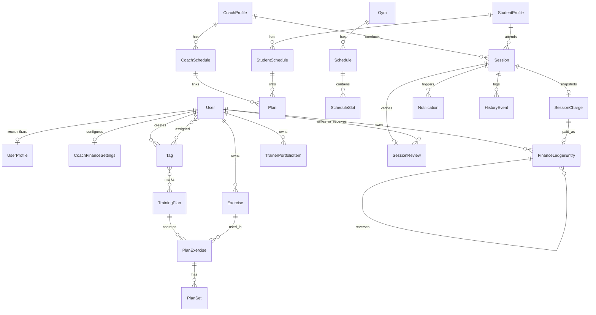

# Доменные сущности

Источник: фрейм «DB Relations» + процессные фреймы.

Схема на доске — черновик. Ниже — нормализованная версия для NestJS + PostgreSQL (с сохранением смысла).

## ER (логический вид)



## Сущности с доски (как есть)

### Gym

```ts
class Gym {
  id: string;
}
```

Справочник места / зала. В MVP достаточно `id`, `name`, опционально адрес.

### Schedule

```ts
class Schedule {
  id: string;
  gymId: string;
  calendar: [
    {
      id: string;
      time: '0 9-18 * * 1'; // cron-подобное выражение слота
      mode: 'online' | 'offline';
    }
  ];
  deletedAt: number; // soft delete
}
```

Центральный хаб доступности. В PostgreSQL лучше вынести `calendar[]` в таблицу `schedule_slots`.

### Coach / Student

```ts
class Coach {
  id: string;
  scheduleId: string[];
}

class Studen { // опечатка на доске → Student
  id: string;
  scheduleId: string[];
}
```

### CoachSchedule / StudentSchedule / Plan

```ts
interface CoachSchedule {
  coachId: string;
  planId: string[];
}

interface StudentSchedule {
  studentId: string;
  planId: string[];
}

class Plan {
  id: string;
  coachScheduleId: string;
  studentScheduleId: string;
}
```

`Plan` — связка «план тренера ↔ план студента» (назначение программы).

## Сущности из процессов (не в code-блоках DB, но нужны)

| Сущность | Смысл |
|----------|--------|
| **Клиент / Студент** | Actor, записывается или записывается тренером |
| **Тренер** | Actor, ведёт график и занятия |
| **Занятие (Session)** | Конкретный слот во времени между тренером и клиентом(ами) |
| **График** | Расписание доступности / слотов |
| **План** | Программа / шаблон тренировок |
| **Начисление (SessionCharge)** | Неизменяемый снимок цены и статус оплаты занятия |
| **Финансовая операция** | Append-only доход, расход или корректировка тренера |
| **Профиль пользователя** | Owner-поля и настройки приватности, отделённые от auth identity |
| **Портфолио тренера** | Упорядоченное публичное представление работ/опыта |
| **Отзыв о занятии** | Rating/text студента, подтверждённые completed Session |
| **Уведомление** | Push / in-app о событии |
| **История** | Аудит / лента прошлых фактов (на диаграммах серым) |
| **Событие** | Доменное событие системы (created/confirmed/cancelled…) |

## Рекомендуемая модель для реализации

### User (базовый аккаунт)

- `id`, `email` / phone, `passwordHash` или OAuth
- `displayName`, `login`
- `roles: ('coach' | 'student')[]`
- `createdAt`, `deletedAt`

### UserProfile

Профиль поверх `User` (1:0..1), отделённый от auth identity:

- `userId`, `displayName`, `avatarUrl`, `bio`
- trainer-поля: `city`, `specialties[]`, `trainingModes[]`
- privacy: `isDiscoverable`, `showRating`, `showReviews`, `showReviewerName`

Профиль тренера публикуется только opt-in; student profile не попадает в discovery.

### Session (занятие)

- `id`
- `coachId`
- `studentIds[]` или отдельная `session_participants` (для групп)
- `startsAt`, `endsAt`
- `mode: online | offline`
- `status: draft | booked | confirmed | cancelled | completed`
- `scheduleSlotId?`
- `planId?` — устаревший alias первой тренировки (`studentPlanId`)
- `workouts[]` — снапшоты тренировок на эту дату (несколько на занятие)
- `recurringBookingId?` — серия, если слот из RecurringBooking
- `createdBy: coach | student`
- `gymId?`

### TrainingPlan (содержание плана)

Отдельно от связки `Plan` на доске:

- `id`, `title` (напр. «Треня на ноги»)
- `ownerCoachId`
- `kind`: `template` | `catalog_seed` | `student_copy` (последний — фаза assign)
- `goal`: `hypertrophy` | `fat_loss` | `general`
- `notes` / `body` — свободный текст; у legacy-планов может быть единственным содержимым
- `plan_exercises[]` + `plan_sets[]` — упорядоченные упражнения и подходы (повторы, вес кг, длительность, отдых)
- `tagIds[]`

Пустой список упражнений допустим. Каталог (`kind=catalog_seed`) только для чтения через API.

Персональные килограммы живут на `student_copy` и на снапшоте занятия, не в библиотеке упражнений.

### Exercise

- `id`, `name`, `kind`: `weight_reps` | `bodyweight_reps` | `duration`
- `ownerCoachId` — `null` для seed-каталога; иначе тренер-владелец
- уникальность `(ownerCoachId, lower(name))`
- без персональных весов ученика (база: имя, kind, теги)

### WorkoutProgram (программа серии)

Одна программа на `RecurringBooking`. Слои:

| Слой | Что хранит |
|------|------------|
| Exercise | база (имя, kind, теги) |
| Template (`kind=template`) | рецепт состава и дефолтных сетов |
| Student copy (`kind=student_copy`) | персональный **start** весов ученика |
| Program | weekday → шаблоны + правила прогрессии + горизонт 1–8 недель |
| Session `workouts[]` + prescription snapshot | факт плана на дату |

`PATCH /plans/:id/loads` меняет кг всех сетов `weight_reps` на шаблоне или копии. Apply программы пишет кривую в снапшоты сессий; ручная правка кг на занятии ставит `override` и не затирается следующим apply.

### CoachFinanceSettings

- `coachId`
- `defaultSessionPriceMinor`, `currency: RUB`
- `updatedAt`

### SessionCharge (начисление)

- `sessionId` (1:1)
- `coachId`, `studentId`
- `amountMinor`, `currency`
- `status: pending | paid | cancelled`
- `earnedAt?`, `paidAt?`, `cancelledAt?`
- `paymentMethod?: cash | transfer | card | other`

Цена создаётся как snapshot при booking. Legacy-занятие без начисления возвращается как `not_tracked`.

### FinanceLedgerEntry

- `coachId`
- `type: income | expense | adjustment`
- `amountMinor`, `currency`
- `sourceType`, `sourceId?`, `category?`, `note?`
- `occurredAt`, `reversesEntryId?`

Журнал append-only: исправления добавляются корректировками. Подробные правила — в [billing.md](billing.md).

### TrainerPortfolioItem

- `id`, `coachId`
- `title`, `description?`, `imageUrl?`
- `sortOrder`, timestamps

### SessionReview

- `id`, `sessionId` (unique)
- `coachId`, `studentId`
- `rating: 1..5`, `text?`
- timestamps

Автор и тренер выводятся из completed Session; рейтинг является производным. Подробные правила — в [social-privacy.md](social-privacy.md).

### Notification / HistoryEvent

Либо отдельные таблицы, либо event store + projections. Для MVP — простые таблицы.

### Invitation (QR)

См. [invitations.md](invitations.md).

### Tag

См. [tags.md](tags.md).

## Soft delete

`Schedule.deletedAt` на доске задаёт паттерн: важные сущности не удаляем жёстко, а помечаем.

## Открытые уточнения по модели

1. Один `User` — обе роли или раздельные аккаунты?
2. Групповое занятие: N студентов на одну `Session`?
3. `Schedule` принадлежит залу, тренеру или обоим?
4. `Plan` на доске — назначение программы или сам контент тренировки? (рекомендация: разделить на `TrainingPlan` + `PlanAssignment`)
