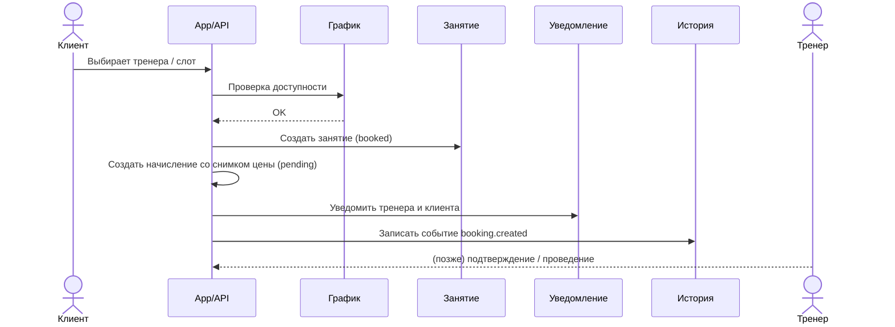

# Процессы

Источники: фреймы процессов записи, «Процесс со стороны клиента/тренера», «Подтверждение…».

## Легенда визуального кодирования (с доски)

На процессных диаграммах элементы стилизованы так:

| Стиль | Интерпретация |
|-------|----------------|
| Сплошная заливка / чёрный | Активные сущности (Клиент, Тренер, Занятие, График…) |
| Пунктир | Опциональные / асинхронные (Уведомление, Событие) |
| Серый | Справочные / пассивные (История, иногда План) |

## A. Запись клиента (приложение установлено) к тренеру

Фрейм: «Запись клиента с установленным приложением на тренировку к тренеру».

Участники: **Клиент**, **Тренер**, **Занятие**, **График**, **План**, **Начисление**, **Уведомление**, **История**, **Событие**.

### Happy path (черновик)



## B. Запись клиента самим тренером

Фрейм: «Запись клиента самим тренером к нему на тренировку».

На доске фрейм почти пустой (только Тренер / Клиент) — процесс нужно допроектировать, но смысл ясен:

1. Тренер открывает подопечного или форму записи.
2. Выбирает слот из своего графика.
3. Создаёт занятие от имени клиента.
4. Клиент получает уведомление.
5. Пишется история / событие.

Отличие от A: `createdBy = coach`.

## C. Подтверждение проведённого занятия

Фрейм: «Подтверждение проведенного занятий тренером» — контейнер без детализации.

Минимальный контракт:

1. Тренер отмечает занятие как **проведённое** (`completed`) или **не состоялось** (`cancelled` / `no_show`).
2. Система пишет событие в историю.
3. Для `completed` начисление становится заработанным, но не оплаченным.
4. Для `cancelled` начисление отменяется; для `no_show` тренер явно выбирает, списывать ли стоимость.
5. Оплата фиксируется отдельно вручную и создаёт доход в финансовом журнале.
6. Для `completed` Session студенту предлагается оставить один проверенный отзыв.

## D. Discovery, профиль и отзыв

1. Тренер заполняет профиль и явно включает публикацию.
2. Авторизованный студент находит тренера в пагинированной ленте.
3. Публичная карточка показывает только разрешённые profile/portfolio/rating/review поля.
4. Discovery не создаёт связь: для booking по-прежнему требуется QR-приглашение.
5. После `completed` Session студент оставляет rating 1–5 и опциональный текст.
6. Система проверяет участника/статус Session и пересчитывает производный рейтинг.
7. Privacy тренера может скрыть профиль, рейтинг или тексты отзывов; privacy студента анонимизирует автора.

## E. Процесс со стороны клиента (карта сущностей)

Активные: Клиент, Тренер, Занятие, График.  
Опциональные: Уведомление, Событие.  
Пассивные: История, План.

Клиентский поток опирается на **выбор слота → занятие → уведомления/история**, план — как контекст «что делать на тренировке».

## F. Процесс со стороны тренера (карта сущностей)

Активные: План, График, Тренер, Начисление, Финансовый журнал.  
Процессные: Занятие, Уведомление, Событие.  
Пассивные: Клиент, История.

Тренерский поток: **план + график → занятие → начисление → ручная оплата/финансовый журнал**, клиент — участник, история — журнал.

## Состояния занятия (предложение)

```text
draft → booked → completed
              ↘ cancelled
booked → no_show (опционально)
```

Правила:

- студент может создавать `booked` только в свободный слот;
- тренер может создавать `booked` для своего студента;
- только тренер (или система по времени) переводит в `completed`;
- отмена — обеими сторонами с политикой (кто / за сколько часов) — TBD.

## События домена (минимум)

- `invitation.created` / `invitation.accepted`
- `session.booked`
- `session.cancelled`
- `session.completed`
- `charge.created` / `charge.earned` / `charge.paid` / `charge.cancelled`
- `finance.expense_recorded` / `finance.adjustment_recorded`
- `profile.published` / `profile.hidden`
- `review.created` / `review.updated`
- `plan.assigned`
- `tag.assigned`

Эти события питают **Историю** и **Уведомления**.

Подробная семантика начислений, расходов и статистики описана в [billing.md](billing.md).
Правила discovery, отзывов и приватности — в [social-privacy.md](social-privacy.md).
